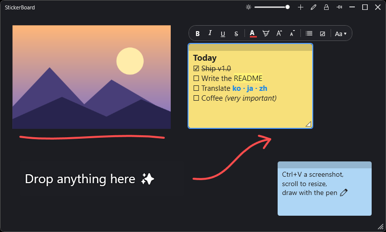

<p align="center"></p>

<h1 align="center">StickerBoard</h1>

<p align="center">
一款輕巧的 Windows 桌面看板 —— 貼圖片、寫便條、隨手塗鴉，<br>
像便利貼一樣放在桌面桌布上隨時使用。
</p>

<p align="center">
<a href="README.md">English</a> · <a href="README.ko.md">한국어</a> · <a href="README.ja.md">日本語</a> · <a href="README.zh-Hans.md">简体中文</a> · <b>繁體中文</b>
</p>

<p align="center"></p>

## 功能

- **圖片** —— 用 `Ctrl+V` 貼上（螢幕擷圖、網頁圖片、複製的檔案），或直接拖曳檔案。拖動角落的控點或滾動滑鼠滾輪調整大小。
- **便條** —— 雙擊空白處新增。支援粗體、斜體、底線、刪除線、文字顏色、醒目提示、局部字級、字型、項目符號和**核取清單**。
- **純文字便條** —— 沒有便條紙，只有文字，柔和的描邊讓它在任何桌布上都清楚易讀。
- **畫筆** —— 可以在任何內容上繪圖和標記，支援復原。
- **常駐桌面** —— 背景不透明度滑桿（可完全透明）、置頂 / 一般 / 位於其他視窗後面、鎖定位置和大小、最大化、視窗符合內容。
- **輕巧** —— 約 0.6 MB 的執行檔，閒置時 CPU 使用率 0%，所有內容自動儲存。
- **語言** —— English、한국어、日本語、简体中文、繁體中文（自動依照 Windows 語言，也可在右鍵選單中切換）。

## 下載

從 **[Releases](https://github.com/Eastar0102/StickerBoard/releases/latest)** 取得最新版本（Windows 10/11，x64）：

| 檔案 | 大小 | 說明 |
| --- | --- | --- |
| `StickerBoard-<版本>-win-x64.exe` | 約 0.6 MB | 需要 [.NET 8 Desktop Runtime](https://dotnet.microsoft.com/download/dotnet/8.0) |
| `StickerBoard-<版本>-win-x64-standalone.exe` | 較大 | 不需安裝任何元件，直接執行 |

不需安裝，直接執行 exe 即可。程式沒有程式碼簽章，第一次執行時 Windows SmartScreen 可能會出現警告（**其他資訊 → 仍要執行**）。

## 使用方式

| 動作 | 方法 |
| --- | --- |
| 貼上圖片 / 文字 | `Ctrl+V`（文字會變成便條） |
| 新增便條 | 雙擊空白處，或按 **+** 按鈕 |
| 移動 | 直接拖曳圖片；便條拖曳頂端的長條 |
| 調整大小 | 角落控點（按住 `Shift` 不維持比例），或在圖片上滾動滑鼠滾輪 |
| 刪除 / 復原刪除 | `Del` / `Ctrl+Z` |
| 便條格式 | `Ctrl+B` `Ctrl+I` `Ctrl+U`，刪除線 `Ctrl+Shift+X`，項目符號 `Ctrl+Shift+L` |
| 核取清單 | `Ctrl+Enter` 新增核取方塊或勾選；點擊 ☐ 也能勾選 |
| 便條字級 | `Ctrl+滾輪` |
| 畫筆 | `P`（`H` 螢光筆，`E` 橡皮擦，`Ctrl+Z` 復原，`Esc` 結束） |
| 最大化 | `F11` 或雙擊標題列 |
| 設定 | 在看板上按右鍵 |

## 資料

所有內容都儲存在 `%APPDATA%\StickerBoard`（`board.json`、`ink.isf`、`images\`）。
可以用環境變數 `STICKERBOARD_DATA` 指定其他資料夾，方便測試或同時執行另一個獨立的看板。

## 建置

需要在 Windows 上安裝 [.NET 8 SDK](https://dotnet.microsoft.com/download/dotnet/8.0)。

```powershell
dotnet run

# 小型單一檔案 exe（需要 .NET 8 Desktop Runtime）
dotnet publish -c Release -r win-x64 --self-contained false -p:PublishSingleFile=true -o publish

# 可獨立執行的單一檔案 exe
dotnet publish -c Release -r win-x64 --self-contained true -p:PublishSingleFile=true `
  -p:IncludeNativeLibrariesForSelfExtract=true -p:EnableCompressionInSingleFile=true -o publish-standalone
```

圖示由 `tools/make-icon.ps1` 產生。

## 翻譯

介面文字位於 [`Strings/`](Strings) 資料夾中的 JSON 檔案（以 `en.json` 為準，缺少的鍵會顯示英文）。
若要新增語言，請將 `en.json` 複製為 `Strings/<代碼>.json` 並翻譯，在 [`Localization.cs`](Localization.cs) 的 `L.Languages` 中加入語言代碼，然後提交 Pull Request。也歡迎改進現有翻譯。

## 授權

[MIT](LICENSE)
